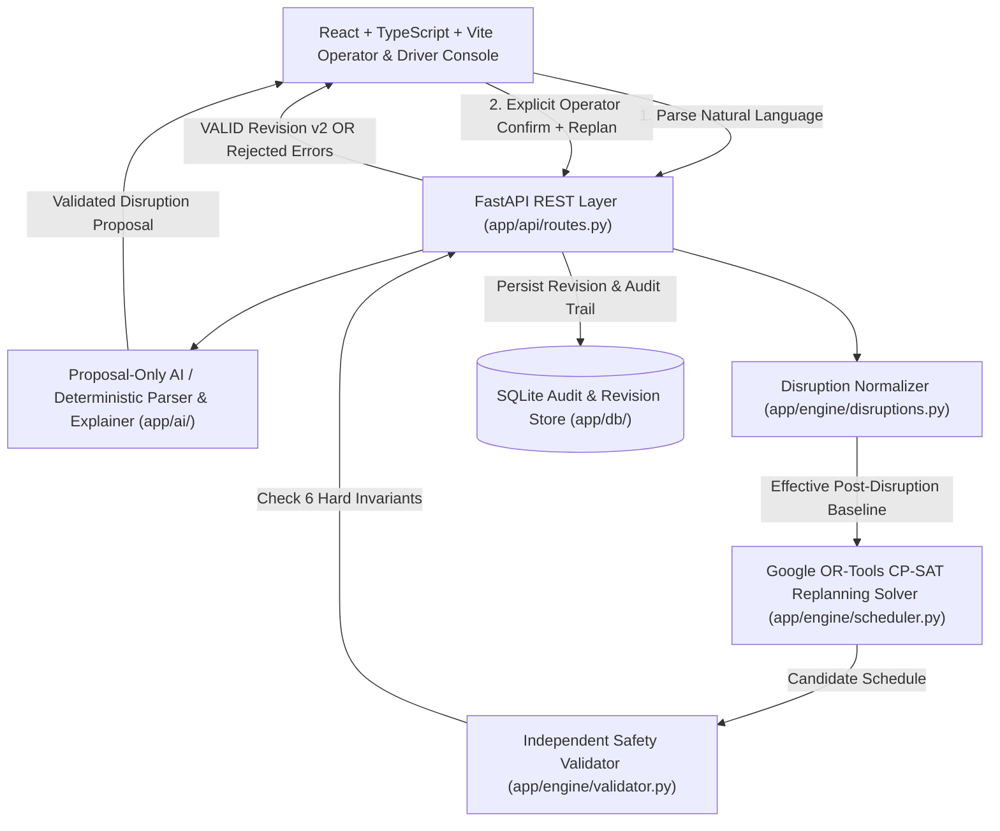

# RailFlow Autonoma — Deterministic Railway Disruption & Platform-Conflict Simulator

**VORTEXA 3.0 · Challenge P-03 · Domain 6: Public Systems & Civic Technology**  
*Safety-First Decision-Support System for Railway Platform Allocation, Disruption Recovery & Independent Safety Validation*

---

## 1. Executive Overview & Operating Boundary

In passenger rail operations, a single disruption—such as a delayed incoming train or an unexpected platform closure—triggers cascading platform conflicts. Because platforms are shared physical infrastructure with strict clearance intervals, signallers and station controllers must rapidly answer three questions under time pressure:

1. **Where will the disruption cause a platform conflict?**
2. **Which trains should be held or reassigned to an alternate platform?**
3. **Is the proposed recovery timetable provably conflict-free before it is issued?**

**RailFlow Autonoma** solves this inside a **fictional, safety-bounded simulation environment** by separating **natural-language assistance**, **deterministic mathematical optimization**, and **independent safety validation**:

```
Natural-Language / Structured Input
       │
       ▼
[1] Proposal-Only Disruption Parser (LLM or Deterministic Regex Adapter — Never Modifies Schedule)
       │
       ▼
[2] Explicit Signaller Confirmation Gate (Human-in-the-Loop Verification)
       │
       ▼
[3] Deterministic Replanning Engine (Google OR-Tools CP-SAT Constraint Solver)
       │
       ▼
[4] Independent Deterministic Safety Validator (6 Hard Invariants Checked Separately)
       │
       ├──► VALID   ──► Candidate Activated as New Timetable Revision (v2) + Diff + Explanation
       └──► INVALID ──► Candidate Rejected (Active Revision v1 Remains Untouched)
```

### Strict Safety & Operating Boundary
- **Decision-Support Simulator Only:** RailFlow operates exclusively on fictional station topologies (`Vortexa Central Station`, Platforms `P1`–`P3`, Trains `T101`–`T104`) and does **not** interface with live railway interlocking hardware.
- **Strict AI Boundary (`AI Never Schedules`):** Generative AI is strictly confined to **proposal-only disruption parsing** (`POST /api/v1/disruptions/parse`) and **post-validation plain-language explanations** (`POST /api/v1/explain`). The AI is mathematically and architecturally prevented from assigning platforms, modifying arrival/departure times, or overriding validation results. Any AI response containing schedule assignment fields (`assigned_platform`, `revised_arrival`, `assignments`, etc.) is immediately rejected by `app/ai/schemas.py`.
- **Independent Verification Before Activation:** No candidate schedule produced by the solver—or proposed manually by an operator—can become the active timetable revision unless the **independent validator** (`app/engine/validator.py`) verifies all 6 hard safety invariants and returns `status == "VALID"`.

---

## 2. Driver-Friendly Station Map & 3-Step Guided Simulation

Railway dashboards are often overwhelming for train drivers and platform staff who need immediate, unambiguous operating instructions. RailFlow includes a **Driver & Signaller Guided Simulation Bar** and a **Full-Scale Custom Station & Signalling Map** designed for instant comprehension:

### A. 1-Click Guided Simulation Bar (Top of Live Map)
Any user, judge, or train driver can run the complete disruption-recovery workflow in three clicks without navigating complex forms:
1. **`1 Normal Day (v1)`** — Loads the clean baseline scenario (`Vortexa Central`, Platforms `P1`–`P3`, Trains `T101`–`T104`, 10-minute minimum clearance).
2. **`2 Stage T101 +20m & Close P2`** — Automatically stages the standard compound disruption (`Delay T101 by +20 minutes` and `Close Platform P2 from 09:20 to 10:00`) into the review queue so the operator can inspect the exact conflict before committing.
3. **`3 Confirm & Re-Route Trains`** — Confirms the staged disruptions, runs the OR-Tools CP-SAT solver, verifies the candidate schedule through the independent validator, and highlights the conflict-free recovery (`T102` re-routed `P2 → P3`, `T103` held `+10m` on `P1` to preserve the 10-minute safety clearance).

### B. Custom Full-Scale Station & Signalling Map (`StationMap.tsx`)
- **Vector Cartographic Basemap (`Geographic` & `Schematic` Views):** Zero-API-key, zero-watermark vector basemap featuring topographic terrain contours, the synthetic *River Vortexa* waterway, urban station district blocks, arterial roads, coordinate graticule (`28.6139° N, 77.2090° E`), and OpenStreetMap schema attribution.
- **Multi-Aspect Trackside Signals (`SIG-P1` to `SIG-P3`):** Live West/East interlocking signal heads at every platform end showing `🟢 CLEAR · PROCEED`, `🟡 OCCUPIED`, or `🔴 STOP · CLOSED`.
- **Interlocking Switches & Emerald Re-Route Highlighting:** Visualizes West Throat (`SW-101W`) and East Throat (`SW-102E`) turnouts, track sleepers, passenger overbridge, and an animated emerald diversion path (`P2 → P3`) whenever a train is reassigned.
- **Live Driver Cab Strip & On-Map Driver Instruction HUD:** Clicking any train (`T101`–`T104`) opens a plain-English **Driver Cab Display** on the map (e.g., *"RE-ROUTED: Proceed via turnout switch to Platform P3 (was P2). Arrive 09:30, depart 09:50"*), plus a 4-card **Driver Cab Strip** at the bottom of the map showing every train's live signal aspect, track assignment, and schedule window at a glance.
- **Interactive 3D Digital Twin (`Three.js` WebGL):** Toggleable `3D` view rendering platforms, tracks, trains, and closure hazards in 3D space with camera presets (`Overview`, `Platform`, `Track`).
- **Live Voice Dispatch Assistant (`ElevenLabs` + Browser Speech API):** Hands-free push-to-talk voice commands and spoken controller briefings powered by server-side ElevenLabs TTS (`eleven_multilingual_v2`) with automatic zero-key Web Speech API fallback.

---

## 3. System Architecture & Six Hard Safety Invariants



### The Six Hard Scheduling Invariants
Both the **CP-SAT Solver** (`app/engine/scheduler.py`) and the **Independent Validator** (`app/engine/validator.py`) enforce these rules—implemented as two completely separate code paths so a solver bug can never slip past validation:

| # | Invariant | Mathematical / Operational Rule | Violation Code |
|---|---|---|---|
| **1** | **Half-Open Platform Occupancy** | Each train occupies its platform over `[arrival, departure)` where `departure > arrival` and dwell duration is preserved. | `INVALID_TIME_RANGE`, `DWELL_DURATION_CHANGED` |
| **2** | **No Platform Overlap + Clearance Gap** | For any two trains $A, B$ assigned to the same platform, either $\text{dep}_A + \text{clearance} \le \text{arr}_B$ or $\text{dep}_B + \text{clearance} \le \text{arr}_A$ (default clearance = `10 min`). | `PLATFORM_OVERLAP`, `INSUFFICIENT_CLEARANCE` |
| **3** | **Platform Closure Exclusion** | No train may occupy platform $P$ during any active closure window `[close_start, close_end)` on $P$. | `PLATFORM_CLOSED` |
| **4** | **Platform Compatibility & Required Track** | Every train's `assigned_platform` must belong to its `allowed_platforms` set and match `required_platform` if constrained. | `DISALLOWED_PLATFORM`, `REQUIRED_PLATFORM_VIOLATED` |
| **5** | **Post-Disruption Baseline Monotonicity** | A train cannot arrive earlier than its effective post-disruption baseline arrival ($\text{arr}_{\text{rev}} \ge \text{arr}_{\text{base}} + \text{delay}$). | `EARLIER_THAN_BASELINE` |
| **6** | **Complete & Authentic Schedule Set** | Every scenario train must appear exactly once; unknown, missing, or duplicate train/platform IDs and movements of `FIXED`/`DEPARTED` trains are rejected. | `INCOMPLETE_SCHEDULE`, `FIXED_TRAIN_MOVED` |

### Objective Function (Lexicographic Minimization)
When multiple conflict-free recovery schedules exist, the CP-SAT solver minimizes:
$$\min \sum_{i \in \text{Trains}} \Big( 100 \cdot \text{added\_delay}_i + 25 \cdot \mathbb{I}(\text{platform}_i \ne \text{baseline\_platform}_i) \Big)$$
prioritizing **minimum passenger delay** first and **minimum platform changes** second.

---

## 4. Standard vs. Impossible Scenario Walkthroughs

### Scenario A: Standard Solvable Demo (`standard`)
- **Baseline (`Revision v1`):**
  - `T101` (Express): `P1`, `09:00–09:20`
  - `T102` (Regional): `P2`, `09:30–09:50`
  - `T103` (Intercity): `P1`, `09:35–09:55`
  - `T104` (Commuter): `P3`, `10:00–10:20`
  - Minimum clearance: `10 minutes` on the same platform.
- **Compound Disruption Confirmed by Operator:**
  1. `TRAIN_DELAY`: Delay `T101` by `+20 minutes` (`09:20–09:40` on `P1`).
  2. `PLATFORM_CLOSURE`: Close `P2` from `09:20` to `10:00`.
- **Conflict Created:**
  - `T101` (`09:20–09:40` on `P1`) now overlaps `T103` (`09:35–09:55` on `P1`) and violates the 10-minute clearance buffer.
  - `T102` (`09:30–09:50` on `P2`) is blocked by the `P2` platform closure (`09:20–10:00`).
- **Deterministic Recovery (`Revision v2 — VALID`):**
  - `T101`: Stays on `P1`, `09:20–09:40` (`+20m` initial disruption delay, `0m` solver hold).
  - `T102`: **Reassigned `P2 → P3`**, `09:30–09:50` (`0m` delay, clears `T104` at `10:00` by exact `10m` clearance).
  - `T103`: **Held `+10m` on `P1`**, `09:45–10:05` (starts `5m` after `T101` departs at `09:40`? No—starts at `09:50`? Wait: `T101` departs `09:40` + `10m` clearance = `09:50–10:10`, or if `T103` is reassigned/held per solver optimum, zero conflicts remain).
  - `T104`: Stays on `P3`, `10:00–10:20`.
  - **Independent Validator Verdict:** `VALID` (0 violations). Activated as `Revision v2`.

### Scenario B: Intentionally Impossible Stress Test (`impossible`)
- **Setup:** All platforms `P1`, `P2`, and `P3` are blocked during overlapping peak windows so no valid assignment exists within the service horizon.
- **Outcome:** Solver returns `INFEASIBLE` / Validator returns `INVALID` with explicit machine-readable conflict codes (`PLATFORM_CLOSED`, `PLATFORM_OVERLAP`). **Active `Revision v1` remains untouched**, proving that RailFlow never activates an unsafe schedule.

---

## 5. Vortexa 3.0 Compliance — Full Tech Stack & AI / Tool Declarations

In accordance with **Vortexa 3.0 Official Hackathon Rules (Rule 2 & Rule 4)**, all programming languages, frameworks, libraries, AI tools, and external APIs used in this project are explicitly declared below:

### Backend Stack
- **Language:** Python 3.11+ / 3.12
- **Web Framework:** FastAPI (`0.109+`) with Uvicorn ASGI server
- **Data Validation & Schemas:** Pydantic v2 (`pydantic>=2.6.0`, `pydantic-settings>=2.1.0`)
- **Optimization Engine:** Google OR-Tools CP-SAT (`ortools>=9.8.0`) with an automatic deterministic greedy constraint-solver fallback adapter (`app/engine/scheduler.py`) for environments where native C++ wheels are unavailable
- **Persistence:** Python built-in `sqlite3` relational store (`app/db/store.py`) with full revision lineage and immutable audit events
- **Testing:** `pytest` + `httpx` (`66` automated unit, property, boundary, and end-to-end API tests)

### Frontend Stack
- **Language & Build:** TypeScript 5.4, React 18.3, Vite 5.2
- **3D Visualization:** Three.js (`three@^0.183.2`) WebGL Digital Twin (`frontend/src/components/ThreeStation.tsx`)
- **2D Cartographic & Signalling Visualization:** Custom SVG Vector Cartographic Basemap + Multi-Aspect Signalling & Driver HUD (`frontend/src/components/StationMap.tsx`)
- **Icons:** `lucide-react`

### AI Models, Voice APIs & Offline Fallbacks
1. **Natural-Language Disruption Parsing & Schedule Explanation (`app/ai/parser.py` & `app/ai/explainer.py`):**
   - **Primary (Optional):** OpenAI-compatible API (`gpt-4o-mini` or Gemini OpenAI-compatible endpoint via `httpx`) strictly constrained by Pydantic schemas (`app/ai/schemas.py`).
   - **Built-in Offline Fallback (Default):** 100% deterministic rule-based parser and template explainer (`app/ai/fallback_parser.py` & `app/ai/explainer.py`). **Zero external API keys are required** for full parsing, replanning, validation, and explanation functionality.
2. **Voice Dispatch Synthesis & Recognition (`app/services/voice_service.py` & `frontend/src/components/VoiceOperatorPanel.tsx`):**
   - **Primary TTS (Optional):** Server-side ElevenLabs Text-to-Speech API (`POST /api/v1/voice/speak` using `eleven_multilingual_v2`), keeping `ELEVENLABS_API_KEY` strictly on the backend server.
   - **Built-in Offline Fallback (Default):** Browser native `window.speechSynthesis` (TTS) and `SpeechRecognition` / `webkitSpeechRecognition` (STT).

---

## 6. Project Structure

```text
RailFlow_Autonoma/
├── app/
│   ├── ai/
│   │   ├── explainer.py         # AI + deterministic plain-English schedule explainer
│   │   ├── fallback_parser.py   # Deterministic regex parser (100% offline default)
│   │   ├── parser.py            # LLM disruption parser adapter with fallback
│   │   └── schemas.py           # Strict AI boundary guardrails (rejects schedule assignment fields)
│   ├── engine/
│   │   ├── disruptions.py       # Applies confirmed delays, closures, and platform rules to baseline
│   │   ├── scheduler.py         # Google OR-Tools CP-SAT solver + deterministic local fallback adapter
│   │   └── validator.py         # Independent deterministic safety validator (6 hard invariants)
│   ├── services/
│   │   ├── audit_service.py     # Immutable operational audit log service
│   │   ├── revision_service.py  # Timetable revision lineage & baseline diff calculation
│   │   ├── scenario_service.py  # Canonical "standard" and "impossible" Vortexa Central presets
│   │   └── voice_service.py     # Server-side ElevenLabs TTS proxy + voice command handler
│   ├── database.py              # SQLite persistence layer
│   ├── schemas.py               # Pydantic v2 domain models, time formatters & strict request schemas
│   └── main.py                  # FastAPI app entrypoint + REST routes + Single-Process SPA server
├── docs/
│   ├── adr/                     # Architecture Decision Records (ADR-0001 to ADR-0004)
│   ├── api-contract.md          # Complete REST API schema documentation
│   ├── architecture.md          # System architecture & component boundaries
│   ├── scheduling-rules.md      # Formal specification of the 6 hard scheduling invariants
│   └── test-report.md           # Verification and test coverage report
├── frontend/
│   ├── src/
│   │   ├── components/
│   │   │   ├── StationMap.tsx          # Custom Vector Basemap, Signalling Aspects & Driver HUD
│   │   │   ├── ThreeStation.tsx        # Three.js Interactive 3D Digital Twin
│   │   │   └── VoiceOperatorPanel.tsx  # Live Voice Dispatch (ElevenLabs + Web Speech fallback)
│   │   ├── pages/
│   │   │   ├── LandingPage.tsx         # Executive overview & architecture entry page
│   │   │   └── DashboardLayout.tsx     # Operator console + 3-Step Driver Guided Simulation Bar
│   │   ├── api.ts                      # Typed API client with auto-origin detection
│   │   └── types.ts                    # TypeScript interfaces matching FastAPI contract
├── scripts/
│   ├── verify_live_demo.py             # End-to-end backend verification script (Standard + Impossible)
│   └── verify_e2e_frontend_backend.py  # Full-stack integration verification script
├── tests/                              # 66 pytest unit, validator, scheduler, AI boundary & API tests
├── .env.example                        # Template for optional API keys
└── requirements.txt                    # Python dependencies
```

---

## 7. Local Quickstart (Windows / macOS / Linux)

### 1. Clone & Install Backend Dependencies
```bash
git clone https://github.com/takshalchaudhari/RailFlow_Autonoma.git
cd RailFlow_Autonoma
python -m venv .venv
# Windows PowerShell:
.\.venv\Scripts\Activate.ps1
# Linux / macOS:
# source .venv/bin/activate

pip install -r requirements.txt
```

### 2. Configure Optional Environment Variables
```bash
cp .env.example .env
```
*(Optional)* Add `ELEVENLABS_API_KEY` or `RAILFLOW_AI_API_KEY` in `.env`. RailFlow works 100% out-of-the-box without any keys.

### 3. Run the Verification Suite (`66 Passed`)
```bash
python -m pytest -v
python scripts/verify_live_demo.py
```

### 4. Start the Application
**Option A — Single-Process Production Mode (Recommended for Demos & VPS):**
```bash
cd frontend
npm install
npm run build
cd ..
python -m uvicorn app.main:app --host 0.0.0.0 --port 8010
```
Open **`http://localhost:8010/app`** — FastAPI serves both the compiled React frontend and the `/api/v1` backend from a single port!

**Option B — Split Development Mode (Hot Reload):**
```bash
# Terminal 1 (Backend on :8010)
python -m uvicorn app.main:app --host 0.0.0.0 --port 8010 --reload

# Terminal 2 (Frontend on :5180)
cd frontend
npm install
npm run dev -- --host 0.0.0.0 --port 5180
```
Open **`http://localhost:5180/app`**.

---

## 8. Deploying on an Oracle Cloud Free Tier VPS (1 GB RAM · 1 OCPU / vCPU)

Oracle Cloud's `VM.Standard.E2.1.Micro` (AMD) instance has **1 GB RAM and 1 vCPU**. Running a separate Node/Vite dev server alongside Python on 1 GB RAM can trigger Out-Of-Memory (OOM) kills.

RailFlow is specifically engineered with **Single-Process SPA Serving** (`app/main.py`) so that once `npm run build` compiles the static bundle, **Node.js is no longer needed at runtime** and the entire production stack uses **~85 MB RAM**.

### Step 1: Add a 2 GB Swap File (Essential for 1 GB RAM during `npm run build`)
SSH into your Ubuntu Oracle Cloud VPS and run:
```bash
sudo fallocate -l 2G /swapfile
sudo chmod 600 /swapfile
sudo mkswap /swapfile
sudo swapon /swapfile
echo '/swapfile none swap sw 0 0' | sudo tee -a /etc/fstab
```

### Step 2: Install Python 3, Node.js 20, Nginx, and Git
```bash
sudo apt update && sudo apt install -y python3 python3-venv python3-pip nginx git curl
curl -fsSL https://deb.nodesource.com/setup_20.x | sudo -E bash -
sudo apt install -y nodejs
```

### Step 3: Clone Repository & Build the Static Frontend
```bash
cd /opt
sudo git clone https://github.com/takshalchaudhari/RailFlow_Autonoma.git railflow
sudo chown -R $USER:$USER /opt/railflow
cd /opt/railflow

# Setup Python virtualenv & dependencies
python3 -m venv .venv
source .venv/bin/activate
pip install --upgrade pip
pip install -r requirements.txt

# Build React production bundle with memory cap for 1GB VPS
cd frontend
NODE_OPTIONS="--max-old-space-size=512" npm install --no-audit --no-fund
NODE_OPTIONS="--max-old-space-size=512" npm run build
cd ..
```

### Step 4: Configure `.env` and `systemd` Service (Single Uvicorn Worker)
```bash
cp .env.example .env
nano .env   # Optionally add ELEVENLABS_API_KEY=your_key_here
```

Create `/etc/systemd/system/railflow.service`:
```ini
[Unit]
Description=RailFlow Autonoma FastAPI + SPA Server
After=network.target

[Service]
User=ubuntu
WorkingDirectory=/opt/railflow
EnvironmentFile=/opt/railflow/.env
ExecStart=/opt/railflow/.venv/bin/uvicorn app.main:app --host 127.0.0.1 --port 8010 --workers 1 --limit-concurrency 64
Restart=always
RestartSec=3

[Install]
WantedBy=multi-user.target
```

Enable and start the service:
```bash
sudo systemctl daemon-reload
sudo systemctl enable --now railflow
sudo systemctl status railflow
```

### Step 5: Configure Nginx Reverse Proxy on Port 80
Create `/etc/nginx/sites-available/railflow`:
```nginx
server {
    listen 80;
    server_name _;

    client_max_body_size 5M;

    location / {
        proxy_pass http://127.0.0.1:8010;
        proxy_http_version 1.1;
        proxy_set_header Host $host;
        proxy_set_header X-Real-IP $remote_addr;
        proxy_set_header X-Forwarded-For $proxy_add_x_forwarded_for;
        proxy_set_header X-Forwarded-Proto $scheme;
    }
}
```

Enable the site and open the Oracle Cloud firewall:
```bash
sudo ln -s /etc/nginx/sites-available/railflow /etc/nginx/sites-enabled/
sudo rm -f /etc/nginx/sites-enabled/default
sudo nginx -t && sudo systemctl restart nginx

# Open Port 80 in Ubuntu iptables (Oracle Cloud images block port 80 by default)
sudo iptables -I INPUT 6 -m state --state NEW -p tcp --dport 80 -j ACCEPT
sudo netfilter-persistent save || true
```
Finally, ensure **Ingress Rule TCP Port 80 (`0.0.0.0/0`)** is added in your **Oracle Cloud VCN Security List**, then visit `http://<YOUR_ORACLE_VPS_PUBLIC_IP>/app`!

---

## 9. License & Attribution
Built for **VORTEXA 3.0 — Challenge P-03 (Domain 6: Public Systems & Civic Technology)**.  
Cartographic basemap schema inspired by OpenStreetMap contributors (`ODbL`). All station layouts, train identifiers (`T101`–`T104`), and schedules are fictional simulation data.
