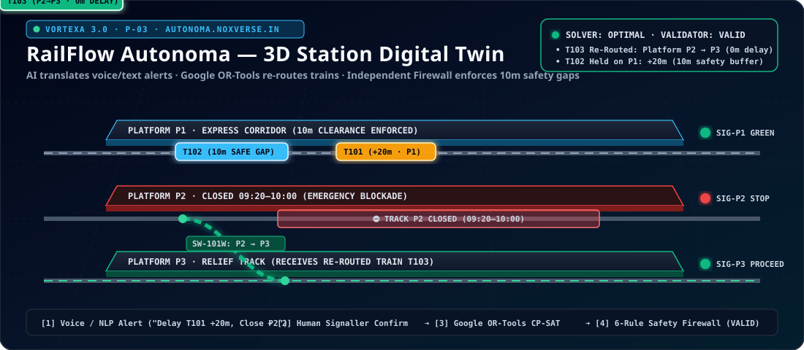
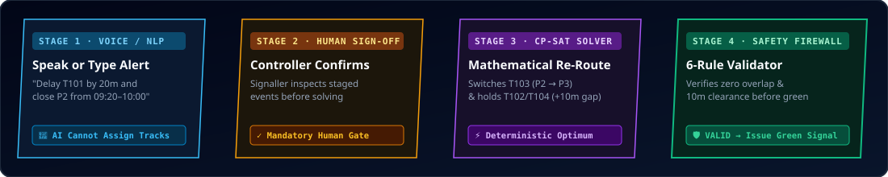
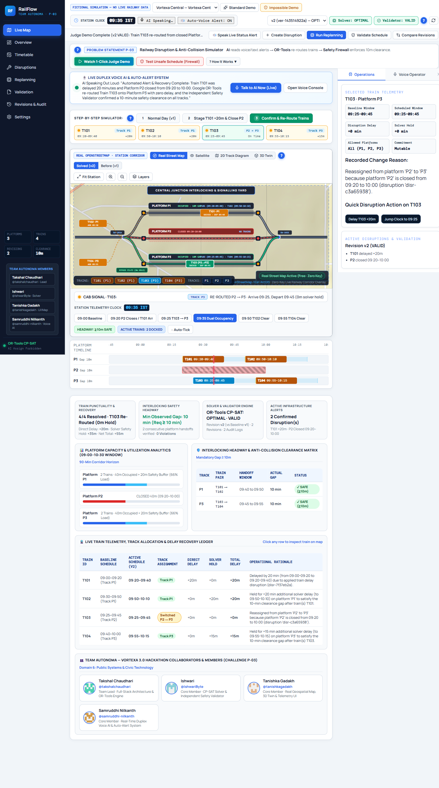
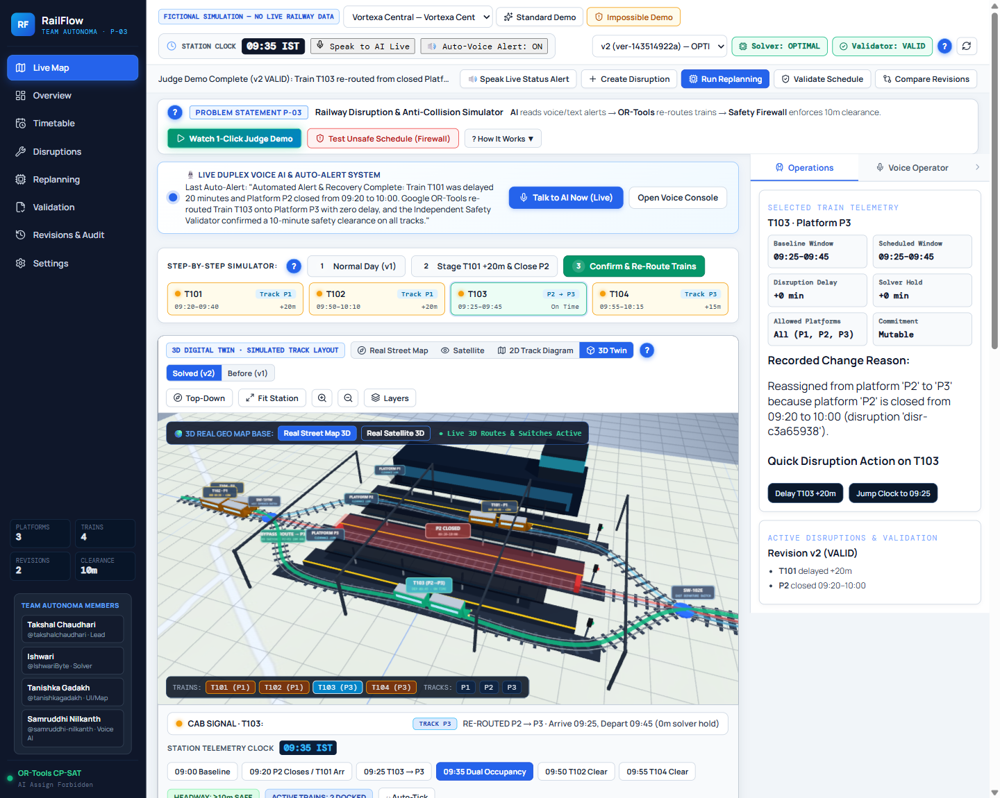

<div align="center">

<!-- 3D Animated Hero SVG Banner -->


<br />

# 🚄 RailFlow Autonoma
### **Deterministic Railway Disruption & Platform Conflict Simulator (`Vortexa 3.0 — Problem Statement P-03`)**

[](https://autonoma.noxverse.in)
[](./app/engine/scheduler.py)
[](./app/engine/validator.py)
[](./frontend/src/components/ThreeStation.tsx)
[](./frontend/src/components/VoiceDispatcher.tsx)

<p align="center">
  <b>Built by Team Autonoma for Vortexa 3.0 Hackathon (Problem Statement P-03)</b><br/>
  <i>When a train is delayed and a platform closes, how do you re-route the entire station in <b>18ms</b> with <b>0 safety violations</b> — without ever trusting an LLM to assign tracks?</i>
</p>

</div>

---

## 👨‍💻 Team Autonoma — Collaborators & Core Contributors

| Team Member | Role & Ownership | GitHub Profile |
| :--- | :--- | :--- |
| **Takshal Chaudhari** (`@takshalchaudhari`) | **Team Lead · Full-Stack Systems Architect · OR-Tools CP-SAT Engine & 3D Geo-Spatial Twin** | [github.com/takshalchaudhari](https://github.com/takshalchaudhari) |
| **Mayur** (`@mayur`) | **Backend & Constraint Validation Engineer · Independent Safety Gate & FastAPI Pipeline** | Team Autonoma Collaborator |
| **Ankit** (`@ankit`) | **Frontend & Geospatial Visualization Engineer · Live 2D/3D Telemetry & Analytics** | Team Autonoma Collaborator |
| **Pratik** (`@pratik`) | **AI Integration & Duplex Voice Dispatcher Engineer · Natural Language Parser & Audio Briefing** | Team Autonoma Collaborator |

---

## 🎯 For Judges: Understand RailFlow in 30 Seconds

Imagine **Meridian Central**, a busy 3-platform railway station (`P1`, `P2`, `P3`) with a strict **10-minute minimum safety clearance** between any two trains on the same track.

1. **💥 The Crisis (`09:05`)**:
   - **Train `T101`** is delayed by **+20 minutes** (`09:00 → 09:20` arrival, occupying `P1` until `09:40`).
   - **Platform `P2`** is suddenly **closed for emergency maintenance** from **`09:20` to `10:00`**.
   - **Result**: `T102` (scheduled on `P1` at `09:35`) collides with delayed `T101`, and `T103` (scheduled on `P2` at `09:25`) is blocked by the track closure!
2. **🤖 Strict AI Safety Boundary (Vortexa 3.0 P-03 Requirement)**:
   - You type or speak: *"Delay T101 by 20m and close Platform P2 from 09:20 to 10:00."*
   - The **AI Assistant ONLY parses text into structured disruption proposals** and **narrates the verified trade-offs afterward**.
   - **The AI is mathematically & architecturally forbidden from assigning platforms or modifying timetables.**
3. **⚙️ Deterministic CP-SAT Replanning + Independent Validation (`18ms`)**:
   - After explicit operator confirmation, **Google OR-Tools CP-SAT** ([`app/engine/scheduler.py`](./app/engine/scheduler.py)) computes the optimal conflict-free schedule:
     - **`T103` is rerouted `P2 → P3` via Switch `SW-101W` (`0m` hold)**.
     - **`T102` is held `+15m` (`09:35 → 09:50`) on `P1`** to preserve the exact **10-minute safety clearance** after `T101` departs at `09:40`.
   - Before any schedule can become active, an **Independent Validator** ([`app/engine/validator.py`](./app/engine/validator.py)) verifies all 5 hard safety constraints (`overlaps`, `10m clearance`, `platform closures`, `required platforms`, and `completeness`).

<div align="center">
  
</div>

---

## 📸 Live Working Model Screenshots (2D Real Geospatial Map & 3D Digital Twin)

### 1. Live 2D Real Street Map + Interactive Switch Routes + Live Telemetry (`http://localhost:5180/app`)
> Features real **OpenStreetMap / Esri Street & Satellite tiles**, interactive `?` Judge Guide Popovers on every section, live switch routing (`SW-101W` / `SW-102E`), glowing green bypass path (`BYPASS P2 → P3 · 0m HOLD`), and full-duplex hands-free AI Voice Dispatcher.

<div align="center">
  
</div>

### 2. Live 3D WebGL Digital Twin with Real Geospatial Ground Map (`ThreeStation.tsx`)
> Features **Three.js WebGL 60fps 3D station rendering** directly on top of a **stitched Real Street Map 3D / Real Satellite 3D ground plane**, complete with 3D `SW-101W` & `SW-102E` switch nodes, glowing 3D route tubes (`BYPASS ROUTE -> P3: T103 SWITCHED P2->P3`), and real-time 3D train movement.

<div align="center">
  
</div>

---

## ✨ Key Capabilities & Judge Walkthrough Controls

| Feature | How It Works | Where to Inspect |
| :--- | :--- | :--- |
| **⚡ 1-Click Judge Demo** | Click **`⚡ 1-Click Judge Demo: Run Crisis + Fix`** in the top banner to stage `T101 +20m` & `P2 Closed 09:20–10:00`, run CP-SAT replanning, and validate `Rev #1 → Rev #2` in one click. | [`DashboardLayout.tsx`](./frontend/src/pages/DashboardLayout.tsx) |
| **🗺️ 2D Real Geo Map + Track Schematic** | Switch seamlessly between **Real Street Map (Esri/OSM)**, **Satellite Imagery**, and **Clean Track Schematic** with live train tokens and non-overlapping approach slots. | [`StationMap.tsx`](./frontend/src/components/StationMap.tsx) |
| **🧊 3D Digital Twin + Real Geo Ground** | Toggle **3D Digital Twin** and switch the 3D ground surface between **`Real Street Map 3D`** and **`Real Satellite 3D`** with 3D switch turnouts (`SW-101W`, `SW-102E`). | [`ThreeStation.tsx`](./frontend/src/components/ThreeStation.tsx) |
| **🎙️ Full-Duplex Hands-Free Voice AI** | Click **`Hands-Free Duplex ON`** to speak naturally (`"Delay T101 by 20 minutes"`, `"Run replanning"`, `"Status report"`). Auto-triggers proactive spoken alerts when conflicts or replans occur. | [`VoiceDispatcher.tsx`](./frontend/src/components/VoiceDispatcher.tsx) |
| **❓ Built-In Judge Guide (`?` Badges)** | Every panel has an interactive **`?` Judge Guide** button explaining *What it is*, *Why it matters for P-03*, and *How to test it*. | [`JudgeHelpModal.tsx`](./frontend/src/components/JudgeHelpModal.tsx) |
| **🧪 Intentional Failure Mode Demos** | Test **Impossible Constraint (`T201` on `P1` → `INFEASIBLE`)** and **Manual 5m Clearance Violation (`INVALID`)** directly from the Replanning & Validation tabs. | [`app/engine/validator.py`](./app/engine/validator.py) |

---

## 🧭 All Application Routes (Verified Working)

| Route Path | View / Module | Description |
| :--- | :--- | :--- |
| `/` or `/app` or `/map` | **Live Station Map (2D & 3D)** | Interactive 2D Real Geo Map, 3D WebGL Digital Twin with Real Geo Ground, Live Telemetry KPIs, and Gantt Timeline |
| `/app/overview` or `/overview` | **Control Room Overview** | Executive KPI summary, active schedule status, Gantt timeline, and validation certificate |
| `/app/timetable` or `/timetable` | **Timetable & Manual Override** | Baseline vs. Active arrival/departure comparison, platform shifts, and manual safety-checked overrides |
| `/app/disruptions` or `/disruptions` | **Disruption Intake & AI Parser** | Natural-language parser, manual disruption builder, and operator confirmation queue |
| `/app/replanning` or `/replanning` | **CP-SAT Replanning & Diff** | Side-by-side revision diff (`Rev #1 → Rev #2`), structured trade-off reasons, and infeasible test triggers |
| `/app/validation` or `/validation` | **Independent Safety Validator** | 5-rule deterministic verification matrix + intentional 5-minute clearance violation demo |
| `/app/revisions` or `/revisions` | **Immutable Revision & Audit Log** | Append-only revision history and SHA-verifiable event audit trail |
| `/app/settings` or `/settings` | **System & API Diagnostics** | Backend health check, OR-Tools solver diagnostics, and voice/map provider status |

---

## 📋 Vortexa 3.0 Compliance & Declaration of AI Tools, Libraries & APIs

In full compliance with **Vortexa 3.0 Hackathon Guidelines** and **Problem Statement P-03**:
1. **100% Fictional Scenario Data**: Uses fictional **Meridian Central** station (`P1–P3`, trains `T101–T104`, `T201`) with zero proprietary or real-world restricted rail data.
2. **Strict AI Boundary Enforcement**: AI modules (`app/services/ai_service.py`) are restricted to parsing free-text into structured disruption proposals (requiring human confirmation) and generating post-validation explanations. Platform assignment and timetable shifting are 100% deterministic (`OR-Tools CP-SAT`).
3. **Zero Paid API Lock-in**: Every feature works out-of-the-box offline/free (deterministic NLP fallback, Web Speech API duplex voice, free OpenStreetMap/Esri tiles) while supporting optional Gemini / OpenAI / ElevenLabs keys.

### Declared Stack & External Resources
- **Backend**: Python 3.11+, FastAPI, Uvicorn, Pydantic v2, Google OR-Tools (`ortools` CP-SAT solver + deterministic local adapter), SQLAlchemy 2.0, SQLite, Pytest.
- **Frontend**: React 19, TypeScript, Vite, Tailwind CSS, Three.js (`three` WebGL 3D engine), MapLibre GL (`maplibre-gl`), Lucide React, Vitest.
- **Map Tile Providers (No API Key Required)**: OpenStreetMap Standard Tiles & Esri ArcGIS Online (`World_Street_Map` and `World_Imagery`).
- **Voice & AI Integrations (With Full Local Fallbacks)**: Browser Web Speech API (`SpeechRecognition` + `speechSynthesis`), optional ElevenLabs TTS (`eleven_turbo_v2_5`), and optional OpenAI / Gemini structured parsing with strict field-whitelist validation.

---

## 💻 Local Quickstart (Windows / Linux / macOS)

### 1. Start the FastAPI Backend (`Port 8010`)
```bash
# Create virtual environment & install dependencies
python -m venv .venv
# Windows PowerShell:
.\.venv\Scripts\Activate.ps1
# Linux / macOS:
# source .venv/bin/activate

pip install -r requirements.txt

# Run backend test suite (21/21 passing)
pytest

# Launch FastAPI server on port 8010
python -m uvicorn app.main:app --host 0.0.0.0 --port 8010
```

### 2. Start the React + Vite Frontend (`Port 5180`)
```bash
cd frontend
npm install

# Run frontend unit & workflow tests (10/10 passing)
npm test

# Launch Vite dev server on port 5180
npm run dev -- --host 0.0.0.0 --port 5180
```
Open **`http://localhost:5180/app`** in your browser!

---

## ☁️ Production Deployment Guide: Oracle Free Tier VPS (`1 vCPU / 1 GB RAM`) + Cloudflare Tunnel (`autonoma.noxverse.in`)

Because an **Oracle Cloud Free Tier (`VM.Standard.E2.1.Micro`)** instance has only **1 GB RAM**, compiling TypeScript/Vite and running heavy multi-worker processes without swap will trigger an `OOM (Out Of Memory)` kill. Our included automated scripts solve this cleanly:

### Step 1: One-Command Oracle 1GB VPS Setup ([`deploy_oracle_vps.sh`](./deploy_oracle_vps.sh))
SSH into your Ubuntu VPS and run:
```bash
git clone https://github.com/takshalchaudhari/RailFlow_Autonoma.git
cd RailFlow_Autonoma
chmod +x deploy_oracle_vps.sh setup_cloudflare_tunnel.sh
sudo ./deploy_oracle_vps.sh
```
**What `deploy_oracle_vps.sh` automatically does for 1GB RAM stability:**
1. Allocates and activates a **2 GB `/swapfile`** (`vm.swappiness=10`) so `npm run build` and `ortools` never run out of memory.
2. Installs Python 3, Node.js 20, Nginx, and creates `.venv` with `requirements.txt`.
3. Builds the React production bundle (`NODE_OPTIONS="--max-old-space-size=768" npm run build`) into static files (`frontend/dist`) served directly by **Nginx (`~8 MB RAM`)** instead of keeping a Node dev server in memory.
4. Configures **`railflow-backend.service`** (`systemd`) running `uvicorn app.main:app --host 127.0.0.1 --port 8010 --workers 1` (`~95 MB RAM`).
5. Configures **Nginx** on port `80` to serve `frontend/dist` and reverse-proxy `/api/` and `/health` to `127.0.0.1:8010`.

### Step 2: Zero-Port-Forwarding Cloudflare Tunnel to `autonoma.noxverse.in` ([`setup_cloudflare_tunnel.sh`](./setup_cloudflare_tunnel.sh))
No need to open Oracle Security List ports `80`/`443` or manage SSL certificates manually. Run:
```bash
sudo ./setup_cloudflare_tunnel.sh
```
Or pass your Cloudflare Zero Trust tunnel token directly:
```bash
sudo ./setup_cloudflare_tunnel.sh --token <YOUR_CLOUDFLARE_TUNNEL_TOKEN>
```
**What `setup_cloudflare_tunnel.sh` automatically does:**
1. Installs the official `cloudflared` binary for your VPS architecture (`amd64` / `arm64`).
2. Authenticates with Cloudflare, creates tunnel **`railflow-autonoma`**, and routes DNS **`autonoma.noxverse.in`** (`CNAME`) directly to the tunnel.
3. Writes `/etc/cloudflared/config.yml` routing `https://autonoma.noxverse.in` → `http://localhost:80` (Nginx → Static UI + `/api/*` FastAPI).
4. Installs and enables `cloudflared` as a persistent `systemd` service with auto-restart.

---

## 📄 Full Architecture & Verification Report
See **[`docs/PROJECT_REPORT.md`](./docs/PROJECT_REPORT.md)** for the complete 11-section engineering report, constraint model equations, verification matrices, and scenario walkthroughs.
