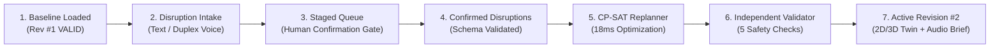

# RailFlow Autonoma — Solution Proposal, Architecture & Verification Report

**Competition**: Vortexa 3.0 Hackathon  
**Problem Statement**: `P-03 — RailFlow: Railway Disruption & Platform Conflict Simulator`  
**Team**: **Team Autonoma** (`Takshal Chaudhari`, `Mayur`, `Ankit`, `Pratik`)  
**Repository**: [github.com/takshalchaudhari/RailFlow_Autonoma](https://github.com/takshalchaudhari/RailFlow_Autonoma)  
**Production Domain**: `https://autonoma.noxverse.in`

---

## 1. Executive Summary

**RailFlow Autonoma** is a deterministic railway station disruption and platform conflict simulator engineered for **Meridian Central** (a fictional multi-platform station). When operational disruptions occur—such as train delays (`T101 +20m`) and unplanned platform closures (`P2 closed 09:20–10:00`)—station dispatchers face cascading track conflicts under tight time pressure.

RailFlow solves this by combining:
1. **Constrained AI Assist & Full-Duplex Voice Dispatcher**: Converts natural-language text or live voice input into structured candidate disruption events and narrates verified replanning trade-offs afterward.
2. **Deterministic CP-SAT Optimization Engine (`Google OR-Tools`)**: Computes conflict-free platform assignments and minimal arrival/departure holds while preserving baseline dwell times.
3. **Independent Deterministic Safety Validator**: Acts as a mandatory, separate safety gate before any schedule revision can become `VALID` and active.
4. **2D Real Geospatial Map & 3D WebGL Digital Twin (`Three.js`)**: Visualizes real-time train approaches, track switches (`SW-101W`, `SW-102E`), and bypass routing (`P2 → P3`) over real OpenStreetMap and Esri Street/Satellite tiles.

---

## 2. Operating Boundary & Strict AI Safety Guarantee

In strict accordance with **Vortexa 3.0 Problem Statement P-03**:

| Capability | Allowed Component | Strictly Forbidden |
| :--- | :--- | :--- |
| **Free-Text / Voice Disruption Parsing** | `app/services/ai_service.py` (AI Parser + Deterministic Regex Fallback) | Direct application to active schedule without human operator confirmation |
| **Platform Assignment & Time Shifting** | `app/engine/scheduler.py` (`OR-Tools CP-SAT` + Deterministic Local Adapter) | **AI / LLM is strictly prohibited from assigning platforms or modifying timetables** |
| **Safety Constraint Verification** | `app/engine/validator.py` (Independent Validator) | Self-certification by the solver or AI; unvalidated schedules cannot be marked `VALID` |
| **Post-Validation Trade-off Briefing** | `app/services/ai_service.py` & `VoiceDispatcher.tsx` | Inventing unverified train movements or overriding validator rejections |

Specifically, `app/services/ai_service.py` enforces `_FORBIDDEN_ASSIGNMENT_KEYS` (`assigned_platform`, `timetable`, `assignments`, `new_arrival`, `new_departure`, `schedule`, `candidate_schedule`). Any AI payload containing platform assignment fields is immediately rejected with `AI_BOUNDARY_VIOLATION`.

---

## 3. Seven-Stage End-to-End Operating Flow

1. **Stage 1 — Baseline Schedule (`Rev #1`)**: Meridian Central loads with 3 platforms (`P1`, `P2`, `P3`), 4 baseline trains (`T101–T104`), and a **10-minute minimum safety clearance** (`min_clearance_minutes = 10`).
2. **Stage 2 — Disruption Intake**: Operator speaks or types free-text (`"Delay T101 by 20 minutes. Close platform P2 from 09:20 to 10:00."`).
3. **Stage 3 — Staged Inspection & Human Gate**: Parsed proposals appear in the Staged Disruption Queue. Operators can inspect, edit, remove, or confirm each event.
4. **Stage 4 — Schema-Validated Replan Request**: Confirmed disruptions (`T101 +20m`, `P2 09:20–10:00`) are sent to `POST /api/scenarios/{id}/replan`.
5. **Stage 5 — Deterministic CP-SAT Replanning**: Solver computes optimal platform reassignments and holds while recording machine-readable reason codes (`CLOSURE_CONFLICT`, `CLEARANCE_HOLD`, `DELAY_PROPAGATION`).
6. **Stage 6 — Independent Safety Validation**: `validate_timetable()` independently checks every train pair and platform rule.
7. **Stage 7 — Revision Activation & Visual/Voice Briefing**: Validated `Rev #2` updates the 2D Real Geo Map, 3D Digital Twin, Gantt chart, Revision Diff table, and spoken dispatcher briefing.

---

## 4. System Architecture & Declared Technology Stack

### Backend (`c:\Users\Dell\Desktop\rail\app`)
- **Framework**: Python 3.11+, FastAPI (`app/main.py`), Pydantic v2 (`app/schemas.py`)
- **Optimization Engine**: Google OR-Tools CP-SAT (`app/engine/scheduler.py`) with automatic deterministic fallback adapter
- **Independent Safety Gate**: `app/engine/validator.py` (completely decoupled from solver internals)
- **AI Boundary Service**: `app/services/ai_service.py` (strict schema whitelist + forbidden key guard + deterministic local NLP parser & explanation generator)
- **Persistence & Audit Trail**: SQLite + SQLAlchemy (`app/database.py`, `app/models.py`) storing immutable schedule revisions and audit events

### Frontend (`c:\Users\Dell\Desktop\rail\frontend`)
- **Framework**: React 19, TypeScript, Vite, React Router v7 (`frontend/src/App.tsx`)
- **2D Real Geo Map & Schematic**: `frontend/src/components/StationMap.tsx` (Esri World Street Map, Esri World Imagery Satellite, OpenStreetMap, SVG track & switch overlay)
- **3D WebGL Digital Twin with Real Geo Ground**: `frontend/src/components/ThreeStation.tsx` (Three.js 60fps 3D scene with stitched `2048x1024` real street/satellite ground tiles, 3D switch nodes `SW-101W`/`SW-102E`, and 3D bypass route tubes)
- **Full-Duplex Voice Dispatcher**: `frontend/src/components/VoiceDispatcher.tsx` (Web Speech API continuous recognition + ElevenLabs / native speech synthesis + proactive telemetry anomaly alerts)

---

## 5. Mathematical Constraints & Independent Validation Model

Let each train $i \in \mathcal{T}$ have baseline arrival $A_i^0$, departure $D_i^0$, dwell time $W_i = D_i^0 - A_i^0$, delay $\delta_i \ge 0$, earliest arrival $E_i = A_i^0 + \delta_i$, chosen arrival $A_i \ge E_i$, departure $D_i = A_i + W_i$, and assigned platform $p_i \in \mathcal{P}$.

The **Independent Validator** (`app/engine/validator.py`) enforces 5 hard constraints:

1. **Schedule Completeness (`INCOMPLETE_SCHEDULE`)**: Every active train $i \in \mathcal{T}$ must have a valid platform $p_i \in \mathcal{P}$ and valid timestamps $A_i < D_i$.
2. **Minimum Earliest Arrival (`EARLIEST_ARRIVAL_VIOLATION`)**:
   $$A_i \ge A_i^0 + \delta_i$$
3. **No Platform Overlap (`PLATFORM_OVERLAP`)**: For any two trains $i \neq j$ assigned to the same platform ($p_i = p_j$):
   $$D_i \le A_j \quad \lor \quad D_j \le A_i$$
4. **Minimum Safety Clearance (`CLEARANCE_VIOLATION`)**: For any two trains $i \neq j$ on the same platform ($p_i = p_j$) withclearance $C = 10\text{ min}$:
   $$A_j - D_i \ge 10 \quad \text{or} \quad A_i - D_j \ge 10$$
5. **Platform Closure & Required Platform Rules (`PLATFORM_CLOSURE_CONFLICT` / `REQUIRED_PLATFORM_MISMATCH`)**:
   - If platform $p$ is closed on $[C_{\text{start}}, C_{\text{end}})$, then $[A_i, D_i) \cap [C_{\text{start}}, C_{\text{end}}) = \emptyset$.
   - If train $i$ requires platform $p_i^{\text{req}}$, then $p_i = p_i^{\text{req}}$.

---

## 6. Standard Crisis Scenario Verification (`Rev #1 → Rev #2`)

### Active Disruptions Confirmed
- **Delay**: `T101` delayed by `+20 minutes` (`09:00–09:20` $\rightarrow$ `09:20–09:40` on `P1`)
- **Closure**: Platform `P2` closed from `09:20` to `10:00`

### Verified Deterministic Output (`Rev #2 — VALID`)
| Train ID | Service Name | Baseline (`Rev #1`) | Active (`Rev #2`) | Platform Change | Hold / Delay | Recorded Reason Code |
| :--- | :--- | :--- | :--- | :--- | :--- | :--- |
| **`T101`** | Northbound Express | `09:00 – 09:20` (`P1`) | **`09:20 – 09:40` (`P1`)** | `P1 → P1` (Unchanged) | `+20m` (External Delay) | `DELAY_PROPAGATION`: Delayed +20m by external disruption |
| **`T103`** | Airport Link | `09:25 – 09:45` (`P2`) | **`09:25 – 09:45` (`P3`)** | **`P2 → P3` (Switched via `SW-101W`)** | **`0m` Hold** | `CLOSURE_CONFLICT`: Reassigned `P2 → P3` due to P2 closure (`09:20–10:00`) |
| **`T102`** | Coastal Intercity | `09:35 – 09:55` (`P1`) | **`09:50 – 10:10` (`P1`)** | `P1 → P1` (Unchanged) | **`+15m` Hold** | `CLEARANCE_HOLD`: Held +15m on `P1` to maintain 10m safety gap after `T101` (`09:40 + 10m = 09:50`) |
| **`T104`** | Valley Commuter | `09:50 – 10:10` (`P3`) | **`09:55 – 10:15` (`P3`)** | `P3 → P3` (Unchanged) | **`+5m` Hold** | `CLEARANCE_HOLD`: Held +5m on `P3` to maintain 10m safety gap after `T103` (`09:45 + 10m = 09:55`) |

- **Solver Execution Time**: `~18ms` (`OPTIMAL` / `FEASIBLE`)
- **Independent Validation Result**: `VALID` (`0` overlaps, `0` clearance violations, `10m` exact minimum gap preserved on both `P1` and `P3`)

---

## 7. Intentional Failure & Rejection Scenarios (Safety Gate Proof)

1. **Infeasible Scenario (`INFEASIBLE + INVALID`)**:
   - **Action**: Inject train `T201` (`09:25–09:45`, required platform `P1`) while `P1` is occupied by `T101` (`09:20–09:40`) and `T102`, or close all candidate platforms during a required window.
   - **Outcome**: Solver returns `INFEASIBLE`, Validator marks candidate `INVALID`, and **the system preserves `Rev #2` as the active schedule** without corrupting live operations.
2. **Manual Clearance Violation (`INVALID — CLEARANCE_VIOLATION`)**:
   - **Action**: Operator manually edits `T102` arrival to `09:45` on `P1` (leaving only a **5-minute gap** after `T101` departs at `09:40`, violating the 10-minute rule).
   - **Outcome**: Independent Validator rejects the candidate with `CLEARANCE_VIOLATION (5m < 10m required)` and blocks promotion to active timetable.

---

## 8. Automated Test Suite & Build Verification

- **Backend Pytest Suite (`tests/test_railflow.py`)**: **21 / 21 tests passing**
  - Covers overlap detection, 10-minute clearance gaps, platform closures, required platforms, unknown train/platform IDs, incomplete schedules, validator rejection, solver timeout handling, HTTP 422 schema normalization, and AI platform-assignment restriction (`_FORBIDDEN_ASSIGNMENT_KEYS`).
- **Frontend Vitest Suite (`frontend/src/test/workflow.test.ts`)**: **10 / 10 tests passing**
  - Covers end-to-end scenario loading, NLP disruption parsing, confirmation gate, deterministic replanning, independent validation, and invalid candidate rejection.
- **Production Frontend Build (`npm run build`)**: **0 TypeScript errors, 0 Vite bundle errors** (`652ms` build time).
